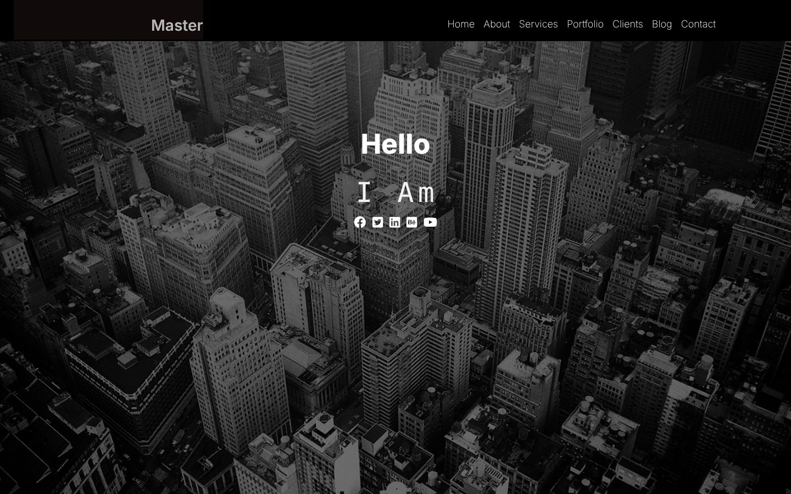
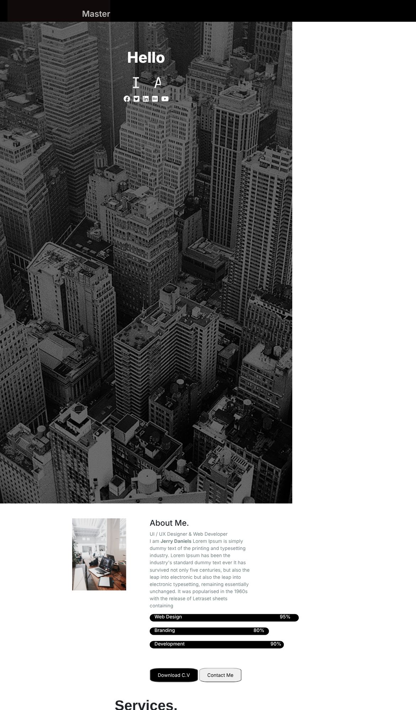
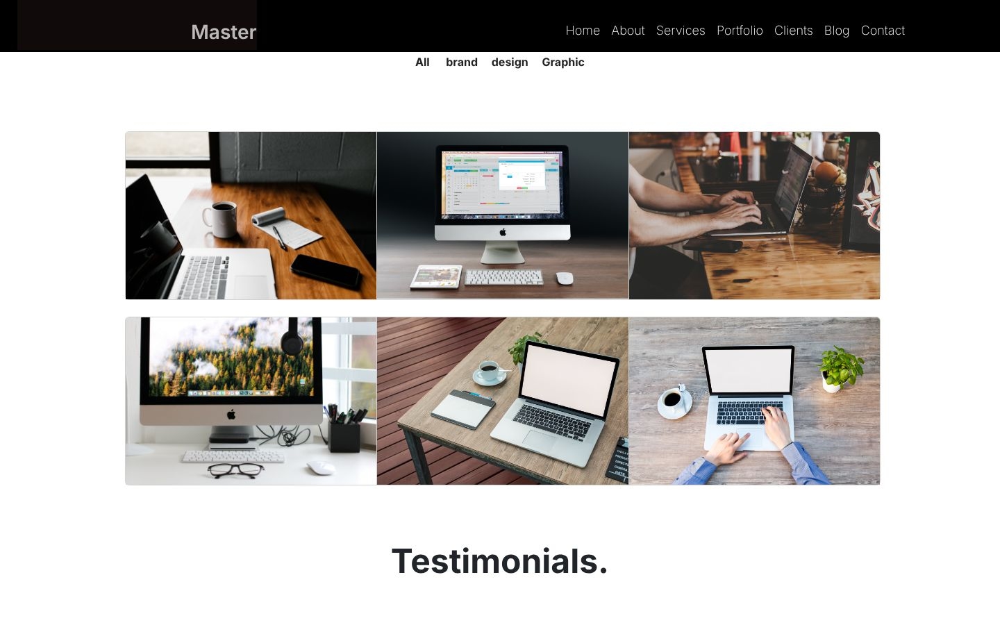

<div align="center">

# Master

### A one-page personal portfolio template built with HTML, CSS and Bootstrap 5

A practice build of a multi-section portfolio layout from my 2022 front-end training: hero with a typing effect, about with skill bars, services, portfolio gallery, testimonials carousel, stats, blog cards and contact.

[](https://developer.mozilla.org/docs/Web/HTML)
[](https://developer.mozilla.org/docs/Web/CSS)
[](https://getbootstrap.com)
[](https://fontawesome.com)
<br>
[](https://eslamraafat1.github.io/Master/)

**[Live demo](https://eslamraafat1.github.io/Master/)** ·
**[Portfolio](https://new-portfolio-ashy-xi.vercel.app/)** ·
**[LinkedIn](https://www.linkedin.com/in/eslamraafat-dev/)** ·
**[Email](mailto:eslamraafat736@gmail.com)**

<br>



</div>

<table>
  <tr>
    <td width="40%"></td>
    <td width="60%"></td>
  </tr>
  <tr>
    <td align="center"><sub>Mobile (iPhone 13)</sub></td>
    <td align="center"><sub>Portfolio gallery section</sub></td>
  </tr>
</table>

---

## Overview

A **learning project** from my 2022 front-end course: recreating a classic one-page portfolio template to practise layout with the Bootstrap 5 grid and components. All copy is the template's placeholder text (the "Jerry Daniels" name, lorem ipsum, sample stats and contact details). It is not my real portfolio; that one is [here](https://new-portfolio-ashy-xi.vercel.app/).

## Features

- **Navbar** with anchor links to every section and a Bootstrap collapse toggle on small screens.
- **Hero** with a CSS-only **typing animation** (`@keyframes typing` with `steps()`) and social icons.
- **About me** with photo, skill progress bars and two call-to-action buttons.
- **Services:** six cards with Font Awesome icons.
- **Portfolio:** a two-row image gallery built with Bootstrap card groups.
- **Testimonials:** Bootstrap carousel (`carousel-dark`, auto-sliding).
- **Stats strip:** four counters with icons (static numbers).
- **Blog:** three cards in a responsive `row-cols-md-4` grid.
- **Contact:** address and email blocks.

There is no custom JavaScript. All behaviour comes from Bootstrap's bundle.

### Known limitations

- The page has no `<meta name="viewport">`, so phones render the desktop layout scaled down.
- The images are uncompressed photos (about 20 MB in total), so the first load is heavy.

## Tech stack

| Layer | Tools |
| --- | --- |
| Markup and styles | HTML5, CSS3 (keyframe animations) |
| UI framework | Bootstrap 5.2 (navbar, grid, cards, carousel), local copy |
| Icons | Font Awesome Free 6.1.2 (local copy) |
| Hosting | GitHub Pages |

## Project structure

```text
.
├── index.html            # all sections
├── style.css             # theme, typing animation, skill bars
├── bootstrap.min.css · bootstrap.bundle.min.js
├── font/ · webfonts/     # Font Awesome
├── image/                # portfolio, testimonial and blog images
├── pexels-*.jpg          # hero background and about photo
└── docs/screenshots/     # README images
```

## Getting started

No build step. Open `index.html` in a browser, or serve the folder:

```bash
git clone https://github.com/Eslamraafat1/Master.git
cd Master
npx serve .          # http://localhost:3000
```

## Deployment

Hosted on **GitHub Pages** from the `master` branch: **https://eslamraafat1.github.io/Master/**

## Author

**Eslam Raafat**, Front-End Developer (React · Next.js · TypeScript)

- **Portfolio:** [new-portfolio-ashy-xi.vercel.app](https://new-portfolio-ashy-xi.vercel.app/)
- **LinkedIn:** [linkedin.com/in/eslamraafat-dev](https://www.linkedin.com/in/eslamraafat-dev/)
- **GitHub:** [@Eslamraafat1](https://github.com/Eslamraafat1)
- **Email:** [eslamraafat736@gmail.com](mailto:eslamraafat736@gmail.com)
